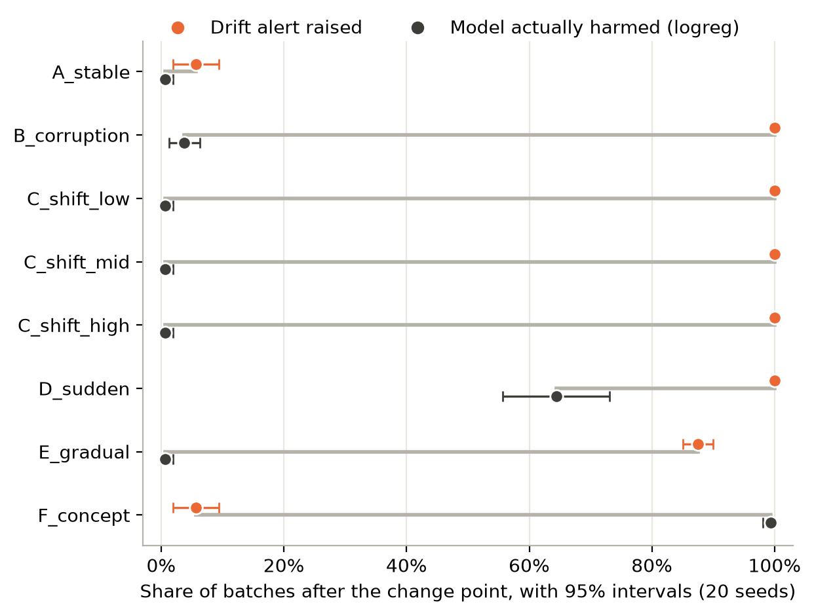

# DriftGuard

A data-quality and drift-monitoring pipeline for tabular ML models, plus
experiments on whether monitoring alerts actually mean the model got worse.

**Research question:** How effectively can data-quality checks combined with
drift detection distinguish harmful distribution changes from harmless shifts
in machine-learning input data?

**Status:** Complete. Pipeline, dashboard, experiments and paper draft are done.
Experiments cover a controlled setting (UCI Adult) and real shift across US
states (Folktables ACSIncome), with two model families and 95% confidence
intervals.

## Key findings

Every alert is scored against three separate questions: did the inputs
change, are they corrupted, and did the model actually get worse? Results come
from 2,560 controlled batches (UCI Adult: 8 scenarios x 20 seeds x 16 batches)
and 1,920 real-shift batches (ACSIncome: models trained on California,
monitored on New York, Texas, Florida and Puerto Rico), each scored for
logistic regression and gradient boosting.

- **Drift alerts rarely meant harm.** Drift detection caught 98% of controlled
  input changes and every real one, with about 5 false alerts per 100 stable
  batches. But only 12% [95% CI 10-14%] of its alerts on Adult, and 33%
  [30-36%] on real shift, were on batches where the model was actually harmed.
- **The most harmful change was invisible.** A change in the label
  relationship harmed both models in almost every batch (logistic regression
  ROC-AUC 0.906 to 0.839), while drift alerts stayed at the false-alert rate.
- **On real shift, the alert couldn't rank harm.** Every state triggered a
  drift alert on every batch, but the model was harmed in 14% of Texas batches
  and 88% of Puerto Rico batches.
- **Harm depends on the model; alerts don't.** Under identical alerts,
  gradient boosting was harmed less than logistic regression by one shift
  (37% vs 64% of batches) and more by another (68% vs 46%).
- **Quality checks name the real cause.** Without a quality gate, drift
  detection blamed a shift in `sex` for all 160 corrupted batches, on both
  datasets; the combined strategy correctly reported a data-quality problem.
- **Robust to the harm threshold.** At thresholds of 0.02, 0.03 and 0.05, at
  most about half of drift alerts coincided with harm (on Adult, at most one
  in five).
- **Reproducible.** Every configuration was committed before its run. A clean
  Docker rerun reproduced the original experiment exactly, and those 640
  batches are identical to seeds 0-4 of the 20-seed run.

Full write-up: [research/paper_draft.md](research/paper_draft.md) ·
Methods: [research/methodology.md](research/methodology.md) ·
Experiment log: [notes/experiment_log.md](notes/experiment_log.md)

## Architecture

Each batch is read, checked against seven data-quality rules, tested for drift
against the training data (Kolmogorov-Smirnov for numeric features, chi-square
for categorical, Bonferroni-corrected), scored by the model when labels are
available, and stored in PostgreSQL. A Streamlit dashboard reads the database;
the experiment runner writes its results to CSV files.

## How to run

### Option A: Docker (no Python or PostgreSQL needed)

    docker compose up -d --build
    docker compose exec app python scripts/run_demo.py

Then open http://localhost:8501. Stop with `docker compose down`.

### Option B: on your own machine

Needs Python 3.12 and PostgreSQL.

    python -m venv .venv
    .venv\Scripts\Activate.ps1          # Mac/Linux: source .venv/bin/activate
    pip install -r requirements.txt
    pip install -e .
    copy .env.example .env               # Mac/Linux: cp; then add your PostgreSQL password
    python scripts/run_demo.py           # data, model, batches, database
    streamlit run dashboard/Overview.py

### Reproduce the experiments and figures

Adult (run_demo.py or src/train_baseline.py first, for the data and logistic regression):

    python scripts/false_alert_check.py                                        # E1: false alerts on stable batches
    python experiments/run_experiments.py                                      # E3: original 5-seed experiment
    python src/train_model.py --dataset adult --model gbm                      # second model
    python experiments/run_experiments.py experiments/configs/adult_20seeds.yaml   # E4 (15-25 min)

Folktables ACSIncome (downloads about 1 GB the first time):

    python src/prepare_acs.py
    python src/train_model.py --dataset acs --model logreg
    python src/train_model.py --dataset acs --model gbm
    python experiments/run_experiments.py experiments/configs/acs_states.yaml      # E5 (15-20 min)

Tables, confidence intervals and figures, for any config:

    python experiments/summarize.py <config>       # results tables
    python experiments/analyze.py <config>         # 95% intervals, harm-threshold sensitivity, figures
    python experiments/make_figures.py <config>    # Adult figures in research/figures/

To check a rerun matches the committed results:

    python experiments/compare_runs.py <first.csv> <second.csv>

### Evidently comparison (E2)

Runs in a separate environment, because Evidently doesn't support pandas 3:

    python -m venv .venv-evidently
    .venv-evidently\Scripts\Activate.ps1
    pip install -r requirements-evidently.txt
    pip install -e .
    python scripts/compare_evidently.py data/batches/batch_001.csv data/batches/batch_shift_age.csv data/batches/batch_shift_marital.csv

### Tests

    pytest

30 tests; they need no data or database and run on every push in GitHub Actions.

## Dashboard

Six pages: overview, data quality, drift, model performance, alert history,
and the experiment results.

## Project structure

    src/driftguard/          the package: config, quality checks, drift tests,
                             alerts, storage, pipeline, scenarios, evaluation, scoring
    src/                     download_data.py, explore.py, train_baseline.py,
                             train_model.py, prepare_acs.py
    scripts/                 demo batches, quick checks, E1, Evidently comparison, run_demo.py
    experiments/             configs (main, adult_20seeds, acs_states), runner, summary,
                             analysis (confidence intervals), figures, run comparison
    experiments/results/     committed experiment results (CSV), one folder per experiment
    dashboard/               Streamlit app (Overview.py + pages/)
    tests/                   pytest suite
    research/                paper draft, methodology, literature review, figures
    notes/                   data findings, drift methods, experiment log (E1-E5)
    reports/                 baseline metrics, allowed-category schemas
    docs/                    screenshots, architecture diagram, demo script

## Models

Seed 42, evaluated on a 20% stratified test split. Logistic regression on Adult
is the model used by the pipeline and dashboard.

| Dataset | Model | Accuracy | F1 | ROC-AUC | PR-AUC |
| --- | --- | --- | --- | --- | --- |
| Adult | Logistic regression | 0.8524 | 0.6589 | 0.9056 | 0.7612 |
| Adult | Gradient boosting | 0.8729 | 0.7122 | 0.9288 | 0.8293 |
| ACSIncome (CA) | Logistic regression | 0.8156 | 0.7762 | 0.8922 | 0.8345 |
| ACSIncome (CA) | Gradient boosting | 0.8188 | 0.7816 | 0.8987 | 0.8500 |

A batch counts as harmful for a model when its ROC-AUC falls more than 0.03
below that model's baseline.

## Limitations

- Two datasets, both US census income data (1994 and 2018), two model
  families and one family of drift tests; results may not generalise beyond
  this setting.
- The Adult shifts are synthetic; the ACSIncome shift is real but geographic
  only, from a single year.
- Harm is defined by a ROC-AUC rule. The main conclusions hold at thresholds of
  0.02 and 0.05, but whether one moderate shift counts as harmful does not.
- The quality schema is learned from one population, so valid but unseen
  categories from another population are rejected as invalid.
- The data includes sensitive attributes (race, sex); this project studies
  monitoring, not fairness.
- Duplicate rows in the original dataset are kept; duplicates within an
  incoming batch are rejected.

More in [research/paper_draft.md](research/paper_draft.md), section 6.

## Design notes

- **No API.** The dashboard reads PostgreSQL directly, and nothing else needed one.
- **Thresholds fixed in advance.** Drift thresholds were fixed, and each
  experiment's configuration committed, before that experiment's first run.
- **One code path for both datasets.** `DRIFTGUARD_DATASET` selects Adult
  (default) or ACS; the experiment configs set it automatically.
- **Separate Evidently environment**, because Evidently doesn't support pandas 3.

## Data

- UCI Adult (Census Income) dataset, CC BY 4.0, downloaded by
  `src/download_data.py`. Source and cleaning steps: [data_source.md](data_source.md).
- Folktables ACSIncome task (Ding et al., 2021), built from the US Census
  Bureau's 2018 American Community Survey and downloaded by `src/prepare_acs.py`.
  The data is not stored in this repository.