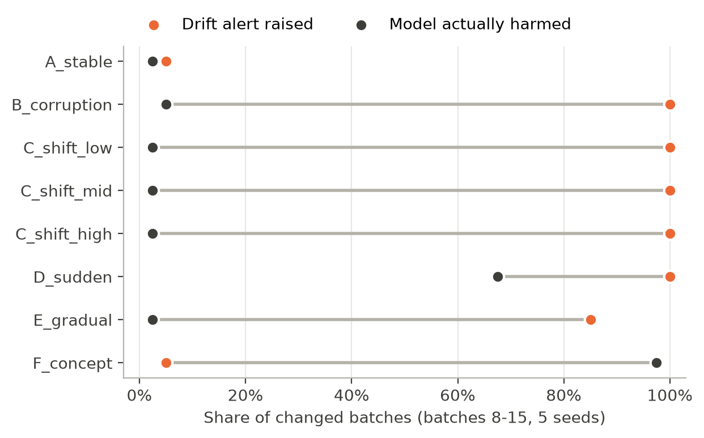
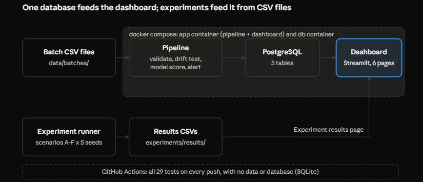
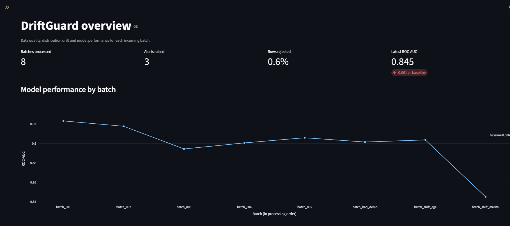
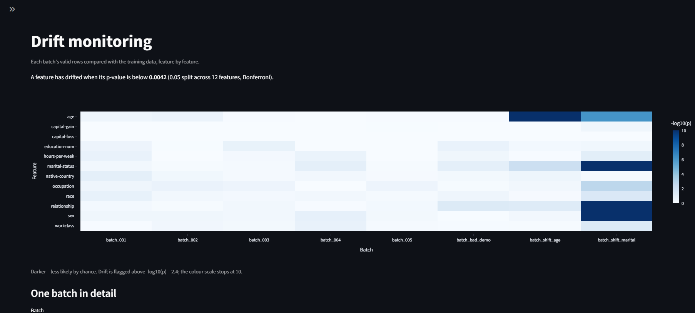
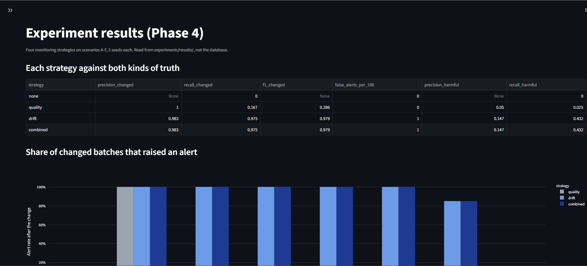

# DriftGuard

A data-quality and drift-monitoring pipeline for a tabular ML model, plus a
controlled experiment on whether monitoring alerts actually mean the model got worse.

**Research question:** How effectively can data-quality checks combined with
drift detection distinguish harmful distribution changes from harmless shifts
in machine-learning input data?

**Status:** Complete. Pipeline, dashboard, experiments and paper draft are done;
results verified by an independent Docker rerun.

## Key findings

From 640 batches (8 controlled scenarios x 5 seeds x 16 batches), comparing four
monitoring strategies against two separate ground truths: did the input data
change, and did the model actually get worse?

- **Drift alerts rarely meant harm.** Drift detection caught 97.5% of input
  changes with 1 false alert per 100 stable batches, but only 35 of its 238
  alerts (15%) were on batches where the model was actually harmed.
- **The most harmful change was invisible.** A change in the label relationship
  harmed the model in 39 of 40 batches (ROC-AUC 0.906 to 0.842), while drift
  alerts stayed at the false-alert rate.
- **Quality checks name the real cause.** Without a quality gate, drift
  detection named a shift in `sex` in all 40 corrupted batches; the combined
  strategy correctly reported a data-quality problem.
- **Fully reproducible.** A clean Docker rerun, with a fresh data download and
  a freshly trained model, reproduced all 640 batch results exactly.

Full write-up: [research/paper_draft.md](research/paper_draft.md) ·
Methods: [research/methodology.md](research/methodology.md) ·
Experiment log: [notes/experiment_log.md](notes/experiment_log.md)

## Architecture

Each batch is read, checked against seven data-quality rules, tested for drift
against the training data (Kolmogorov-Smirnov for numeric features, chi-square
for categorical, Bonferroni-corrected), scored by the model when labels are
available, and stored in PostgreSQL. A Streamlit dashboard reads the database;
the experiment runner writes its results to CSV files.

## How to run

### Option A: Docker (no Python or PostgreSQL needed)

    docker compose up -d --build
    docker compose exec app python scripts/run_demo.py

Then open http://localhost:8501. Stop with `docker compose down`.

### Option B: on your own machine

Needs Python 3.12 and PostgreSQL.

    python -m venv .venv
    .venv\Scripts\Activate.ps1          # Mac/Linux: source .venv/bin/activate
    pip install -r requirements.txt
    pip install -e .
    copy .env.example .env               # Mac/Linux: cp; then add your PostgreSQL password
    python scripts/run_demo.py           # data, model, batches, database
    streamlit run dashboard/Overview.py

### Reproduce the experiments and figures

    python scripts/false_alert_check.py       # E1: false alerts on stable batches
    python experiments/run_experiments.py     # E3: main experiment (3-5 min)
    python experiments/summarize.py           # results tables
    python experiments/make_figures.py        # figures in research/figures/

To check a rerun matches the committed results:

    python experiments/compare_runs.py <first.csv> <second.csv>

### Evidently comparison (E2)

Runs in a separate environment, because Evidently doesn't support pandas 3:

    python -m venv .venv-evidently
    .venv-evidently\Scripts\Activate.ps1
    pip install -r requirements-evidently.txt
    pip install -e .
    python scripts/compare_evidently.py data/batches/batch_001.csv data/batches/batch_shift_age.csv data/batches/batch_shift_marital.csv

### Tests

    pytest

29 tests; they need no data or database and run on every push in GitHub Actions.

## Dashboard

Six pages: overview, data quality, drift, model performance, alert history,
and the experiment results.

## Project structure

    src/driftguard/          the package: config, quality checks, drift tests,
                             alerts, storage, pipeline, scenarios, evaluation, scoring
    src/                     download_data.py, explore.py, train_baseline.py
    scripts/                 demo batches, quick checks, E1, Evidently comparison, run_demo.py
    experiments/             config (main.yaml), runner, summary, figures, run comparison
    experiments/results/     committed experiment results (CSV)
    dashboard/               Streamlit app (Overview.py + pages/)
    tests/                   pytest suite
    research/                paper draft, methodology, figures
    notes/                   data findings, drift methods, experiment log (E1-E3)
    reports/                 baseline metrics, allowed-category schema
    docs/                    screenshots, architecture diagram, demo script

## Baseline model

Logistic regression, seed 42, evaluated on a 20% stratified test split.

| Metric | Value |
| --- | --- |
| Accuracy | 0.8524 |
| Precision | 0.7366 |
| Recall | 0.5961 |
| F1 | 0.6589 |
| ROC-AUC | 0.9056 |
| PR-AUC | 0.7612 |

## Limitations

- One dataset (1994 US census), one model, one family of drift tests; results
  may not generalise beyond this setting.
- All shifts are synthetic, with 5 seeds per scenario.
- Harm is defined by one rule (ROC-AUC more than 0.03 below baseline).
- The data includes sensitive attributes (race, sex); this project studies
  monitoring, not fairness.
- Duplicate rows in the original dataset are kept; duplicates within an
  incoming batch are rejected.

More in [research/paper_draft.md](research/paper_draft.md), section 6.

## Design notes

- **No API.** The dashboard reads PostgreSQL directly, and nothing else needed one.
- **Thresholds fixed in advance.** Drift thresholds and the experiment
  configuration were committed before the first experimental run.
- **Separate Evidently environment**, because Evidently doesn't support pandas 3.

## Data

UCI Adult (Census Income) dataset, CC BY 4.0, downloaded by
`src/download_data.py`. Source and cleaning steps: [data_source.md](data_source.md).