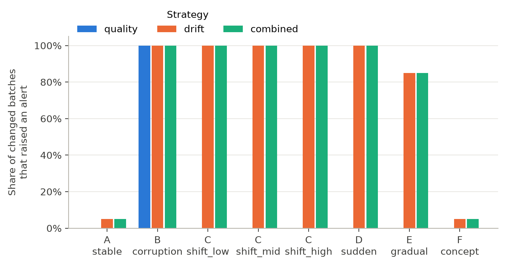
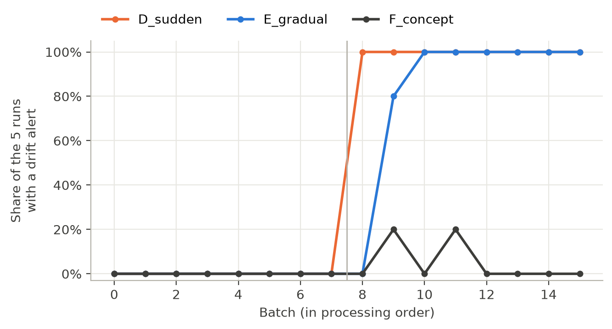
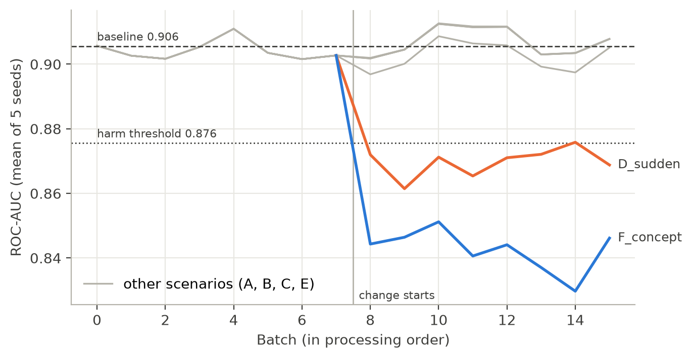

# Do Monitoring Alerts Mean Model Harm? A Controlled Comparison of Data-Quality Checks and Drift Detection on Tabular Data

Alishba Ansari
Independent researcher, Mumbai, India
alishba25ansari@gmail.com

---

## Abstract

We separate three questions that monitoring evaluations often merge: whether inputs changed, whether they are corrupted, and whether the model was harmed.Machine-learning systems can receive input data that is malformed or that
differs from the data used to train the model, but a monitoring alert does not
necessarily indicate that the model's performance has degraded. This paper
compares four monitoring strategies: no monitoring, data-quality checks only,
statistical drift detection only, and both combined, on a logistic regression
model for the UCI Adult income task. We evaluate every alert against two
distinct ground truths across 640 batches of data, covering eight controlled
scenarios and five random seeds: (1) whether the input data changed, and
(2) whether the model's ROC-AUC fell by more than 0.03. Drift detection
reported 97.5% of changes in the input data with 1 false alert per 100
unchanged batches, but only 35 of its 238 alerts (15%) occurred on batches
where the model was actually harmed. A change in the label relationship harmed
the model in 39 of 40 batches, while drift alerts stayed at the level observed
on stable data. Without a quality gate, drift detection attributed all 40
corrupted batches to a change in the distribution of the sex feature; combining
both methods left detection unchanged but correctly identified the cause as a
data-quality problem. All results were reproduced exactly in an independent
containerised rerun. The results show that monitoring the input features alone
cannot establish whether a model has degraded.

## 1. Introduction

A deployed machine-learning model keeps producing predictions regardless of
the data it receives. That data may be malformed (for example, missing values,
impossible numbers or unknown categories) or valid but different from the
training data (for example, because the population has changed). Many of these
changes do not harm the model's predictions, while some do. Monitoring systems
therefore have to answer two separate questions:

1. Has the data changed?
2. Does the change harm the model?

These are three different questions, and we keep them separate throughout.
A *distribution change* is any difference between incoming inputs and the
training data, such as a new mix of people. *Data corruption* is input that
is invalid: missing required values, impossible numbers, unknown categories,
duplicated records. *Performance harm* is a measurable drop in the model's
predictive quality on the batch. A drift detector answers the first question,
a data-quality gate the second, and only labels can answer the third. The
three are easily conflated: corrupted values can look like a distribution
change to a drift test, a large distribution change can leave a model's
performance intact, and a change in the relationship between inputs and
labels can harm the model while leaving the inputs, and so every input
monitor, unchanged.

In production ML systems, it is common practice to validate data quality and to
monitor statistical drift [Breck et al. 2019; Schelter et al. 2018]. Simple
per-feature drift tests have been found to be effective detectors of dataset
shift [Rabanser et al. 2019], and many shifts are harmless, so detecting
harmful shifts requires knowledge of model performance [Podkopaev & Ramdas
2022]. In the work we reviewed, we did not find a controlled comparison of
quality-only, drift-only and combined monitoring in which every alert is scored
against both input change and observed performance harm.

This paper asks: how effectively can data-quality checks combined with drift
detection distinguish harmful distribution changes from harmless changes in
machine-learning input data? We build a minimal end-to-end batch pipeline and
run a controlled experiment with known changes, so that each alert can be
checked against what actually happened.

Our contribution is empirical. The individual components we use (per-feature
drift tests, rule-based data validation, and the observation that drift and
harm differ) are all established. What we add is an evaluation that measures
them against each other:

1. **Three separate ground truths on the same batches.** Every batch records
   whether its inputs changed, whether they were corrupted, and whether the
   model was harmed, and every alert is scored against each. This lets us
   report, for the same alerts, how well they detect change, whether they
   attribute corruption correctly, and how often they coincide with harm.
2. **A controlled and a real-shift setting.** Eight controlled scenarios on
   UCI Adult (corruption; sudden, gradual and label-relationship changes), and
   real geographic shift on Folktables ACSIncome, where models trained on
   California are monitored on four other US populations.
3. **Two model families and quantified uncertainty.** Logistic regression and
   gradient-boosted trees, 20 seeds per scenario, 95% confidence intervals from
   a bootstrap over seeds, and a sensitivity analysis of the harm threshold.
4. **Full reproducibility.** Configurations committed before each run, and
   code that rebuilds every number and figure, verified by an independent
   containerised rerun.

We test four hypotheses:

- **H1:** A data-quality gate catches malformed, missing, duplicated or
  out-of-range records that drift detection alone may not classify correctly.
- **H2:** Combining quality and drift monitoring is more informative than
  either alone, though it may not be better on every measure.
- **H3:** Drift detection depends on the type and magnitude of the shift.
- **H4:** Feature drift does not always correspond to poorer predictive
  performance.

## 2. Related work

We organise prior work by which of the three questions it addresses:
whether the input distribution has changed, whether the input data is
corrupted, and whether the model's performance has been harmed. Table 1
summarises the comparison.

**Detecting distribution change.** Gama et al. [2014] and Lu et al. [2019]
survey learning under concept drift and establish the vocabulary used here:
sudden and gradual drift, and the distinction between a change in the input
distribution and a change in the relationship between inputs and labels.
Rabanser et al. [2019] compare methods for detecting dataset shift and find
that per-feature univariate tests with a Bonferroni correction perform
comparably to multivariate two-sample tests; our drift detector follows this
design. Poenaru-Olaru et al. [2022] ask whether drift detectors are reliable
as alarm systems, measuring detection latency and false alarms, and conclude
that they are not fully reliable. Both studies evaluate how well a detector
finds a change. We take detection as largely solved for the shifts we study
and ask a different question: what a correct detection tells an operator
about the model.

**Detecting corrupted data.** Breck et al. [2019] describe schema-based data
validation in Google's TFX platform, Schelter et al. [2018] declarative
data-quality verification at Amazon, and Sculley et al. [2015] identify data
dependencies as a source of hidden technical debt in ML systems. This work
treats validation as a separate safeguard; it does not measure what a drift
detector reports when corrupted data reaches it, or whether a quality failure
harms the model. We measure both.

**Establishing performance harm.** Several works argue that a shift matters
only if it degrades the model. Rabanser et al. [2019] approximate a shift's
malignancy with a heuristic that needs a labelling function. Podkopaev and
Ramdas [2022] track a deployed model's risk with sequential tests that use
labels and raise an alarm only for harmful shifts. Dong et al. [2024] identify
regions of the input space where a model is less accurate and treat covariate
shift as harmful only when more serving data falls into them, then mitigate it
by retraining with expert labels. These methods detect harm well, but each
requires labels at monitoring time and none evaluates a conventional input
monitor against harm. Our study is complementary: it measures how often the
alerts of label-free monitors, which are what most pipelines run, coincide
with harm that labels later reveal.

**Tools and benchmarks.** Evidently is a widely used open-source monitoring
library; with reference data of more than 1,000 rows it uses distance
measures rather than hypothesis tests by default [Evidently AI]. Folktables
[Ding et al. 2021] and TableShift [Gardner et al. 2023] provide tabular data
with real, naturally occurring shifts, and Ding et al. document limitations
of the UCI Adult dataset. We use Folktables for our real-shift experiment.

**Table 1.** Which of the three questions each line of work addresses.

| Work | Distribution change | Data corruption | Performance harm | Labels needed when monitoring |
| --- | --- | --- | --- | --- |
| Rabanser et al. 2019 | Detects | No | Approximated (heuristic) | For the harm estimate |
| Poenaru-Olaru et al. 2022 | Detects; evaluates reliability | No | Not measured | No |
| Breck et al. 2019; Schelter et al. 2018 | Partly (skew checks) | Detects | Not measured | No |
| Podkopaev & Ramdas 2022 | Not the target | No | Detects | Yes |
| Dong et al. 2024 | Detects covariate shift | No | Detects | Some (expert labels) |
| **This work** | **Detects; scored vs. truth** | **Detects; scored vs. truth** | **Measured; alerts scored vs. it** | **No (labels used only for evaluation)** |

## 3. Methods

The thresholds and drift-detection methods were fixed, and the experiment
configuration was committed to version control, before any experimental
scenario was run.

### 3.1 Data and splits

We use the UCI Adult (Census Income) dataset [Becker & Kohavi 1996], where
the task is to predict whether a person's income exceeds $50K. Cleaning was
limited to stripping spaces from text values, converting "?" to missing
values, and removing a trailing full stop from some income labels, leaving
48,842 rows of which 23.9% earn more than $50K.

The data was split, stratified by income with a fixed seed, into a training
split (29,305 rows, 60%), a test split (9,768 rows, 20%) and a monitor pool
(9,769 rows, 20%). The training split is used to fit the model, as the
reference for drift detection, and to define allowed categories; the test
split measures the baseline model; and every incoming batch is built from
the monitor pool. The three splits share no rows.

### 3.2 Model

We use logistic regression [Pedregosa et al. 2011] inside a single pipeline
with its preprocessing. The five numeric features (age, education-num,
capital-gain, capital-loss, hours-per-week) are median-imputed and
standardised; the seven categorical features (workclass, marital-status,
occupation, relationship, race, sex, native-country) are imputed with the most
frequent value and one-hot encoded, ignoring categories not seen in training.
We exclude fnlwgt, a census sampling weight, and education, which duplicates
education-num. All preprocessing is learned from the training split only. On
the test split the baseline model achieved ROC-AUC 0.906, PR-AUC 0.761,
accuracy 0.852, precision 0.737, recall 0.596 and F1 0.659.

### 3.3 Data-quality checks

Each batch is first read as text, so that converting values to numbers is
itself a check rather than a silent step. Seven rules are applied (Table 1).
Critical failures make the whole batch unusable; errors cause only the
affected rows to be rejected.

**Table 1.** Data-quality rules.

| Rule | Fails when | Severity |
| --- | --- | --- |
| Not empty | The batch has no rows | Critical |
| Required columns | Any of the 12 feature columns is absent | Critical |
| Numeric type | A numeric column holds a non-number | Error |
| Not missing | A value is missing outside workclass, occupation and native-country | Error |
| Allowed category | A category never seen in the training split | Error |
| Range | age outside [17, 100], education-num outside [1, 16], capital-gain or capital-loss outside [0, 99999], hours-per-week outside [1, 99] | Error |
| Duplicate row | An exact copy of an earlier row in the batch (first copy kept) | Error |

Ranges were set from what is plausible rather than from the training minimum
and maximum, so that normal but rare values are not rejected. Every rule is
recorded for every batch, including rules with no failures.

### 3.4 Drift detection

Each batch is compared with the training split, since drift means "different
from what the model learned". Numeric features are tested with the two-sample
Kolmogorov-Smirnov (KS) test, which measures the largest gap between the two
cumulative distributions; categorical features are tested with a chi-square
test of their category proportions [Virtanen et al. 2020]. For categorical
features, missing values are treated as their own category, so a sudden rise
in missing values is visible, and categories with less than 1% of the
reference are grouped together, because chi-square is unreliable for
categories expected only a few times per batch.

With 12 features tested per batch, a per-test threshold of 0.05 would raise
frequent false alarms. We therefore apply a Bonferroni correction, flagging a
feature only when its p-value is below 0.05 / 12 = 0.0042. In a preliminary
test on 100 stable 1,000-row batches, this reduced batches with false alerts
from 37 to 3. Because the features are correlated, the correction is stricter
than necessary.

A quality alert is raised when a batch is unusable or more than 1% of its
rows are rejected; a drift alert is raised when at least one feature drifts,
naming every drifted feature.

### 3.5 Experiment design

**Runs.** Each run is a sequence of 16 batches of 600 rows, processed in
order, built by shuffling the monitor pool with the run's seed and cutting
consecutive, non-overlapping batches. A scenario's change is applied from
batch 8 onwards, so batches 0-7 are always unchanged. Each scenario is run
with five seeds, giving 8 scenarios x 5 seeds x 16 batches = 640 batches.
For a given seed, every scenario starts from the same base batches, so
differences between scenarios are caused by the applied change rather than by
which rows were drawn.

**Scenarios.** Table 2 lists the eight scenarios. Scenarios C, D and E keep
every row valid, so they test drift detection rather than the quality checks.
Each applied change and its severity is recorded per batch as ground truth,
separately from anything the monitors receive.

**Table 2.** Scenarios, applied to batches 8-15.

| Scenario | Change applied | Inputs changed? |
| --- | --- | --- |
| A_stable | None | No |
| B_corruption | 5% of rows broken, split evenly over missing age, sex = "Unknown", age = 250, hours-per-week = "forty", and duplicated rows | Yes |
| C_shift_low / mid / high | hours-per-week increased by 2, 5 or 10, rounded and clipped to [1, 99] | Yes |
| D_sudden | Batch rebuilt to be 70% Married-civ-spouse (about 46% in the full dataset) | Yes |
| E_gradual | age increased by 1.25 years at batch 8, growing linearly to 10 years at batch 15, clipped to [17, 100] | Yes |
| F_concept | Income label flipped for 35% of Married-civ-spouse rows; inputs unchanged | No |

**What the monitors see.** Each batch is written to CSV and read back
through the pipeline's own reader, so monitors receive exactly what a real
file would provide. The income column is removed before monitoring; labels
are used only to compute the ground truth.

**Strategies.** Four strategies are evaluated on the identical batches.
*None* never alerts. *Quality only* raises the quality alert described above.
*Drift only* tests every feature on the raw batch, where non-numbers in
numeric columns become missing and invalid categories are kept. *Combined*
raises a quality alert, or a drift alert computed on the batch's valid rows.

**Ground truth.** Two truths are recorded for every batch and never combined.
The first, *input changed*, is known by construction: it is false for A, for
F, and for every batch before batch 8. The second, *harmful*, is true when the
model's ROC-AUC on the batch, computed with its true labels and with no rows
removed,is more than 0.03 below the model's baseline ROC-AUC on the test split,0.9056 (reported as 0.906 elsewhere), that is, below 0.8756.
We use ROC-AUC rather than PR-AUC because PR-AUC also moves when the share of
high earners changes, as it does in D, even when the model ranks people
equally well. On unchanged batches ROC-AUC averaged 0.904 with a standard
deviation of 0.011, so the threshold lies about 2.6 standard deviations below
normal.

**Metrics.** We report alert precision, recall and F1 against each ground
truth separately, treating precision as undefined for a strategy that raises
no alerts; false alerts per 100 batches whose inputs did not change (400
batches); detection delay, the number of batches from batch 8 to a run's first
alert, averaged over runs that alerted, with missed runs counted separately;
the mean ROC-AUC and share of harmful batches after the change; which cause
each strategy reported for corrupted batches; and monitoring runtime.

**Comparison with Evidently.** Separately, we compared our detector with
Evidently's default data drift preset (version 0.7) on one clean and two
shifted 1,000-row demonstration batches.

## 4. Results

### 4.1 Overall comparison

Table 3 summarises each strategy against both ground truths.

**Table 3.** Strategy performance over all 640 batches.

| Strategy | Recall (input change) | Precision (input change) | False alerts / 100 quiet batches | Share of alerts on harmful batches | Harmful batches alerted |
| --- | --- | --- | --- | --- | --- |
| None | 0.00 | undefined | 0 | undefined | 0 of 81 |
| Quality only | 0.17 | 1.00 | 0 | 5% (2 of 40) | 2 of 81 |
| Drift only | 0.975 | 0.983 | 1.0 | 15% (35 of 238) | 35 of 81 |
| Combined | 0.975 | 0.983 | 1.0 | 15% (35 of 238) | 35 of 81 |

"Quiet" batches are the 400 whose inputs were not changed. "Harmful" means a
ROC-AUC below 0.8756 (0.03 below the 0.9056 baseline).

Drift-only and combined monitoring made identical alert decisions on every
batch. Both detected input changes with high recall and precision, but most
of their alerts fell on batches where the model was not harmed.

### 4.2 Detection by scenario

**Figure 1.** Share of changed batches (batches 8-15, all seeds) that raised
an alert, by strategy and scenario.

Quality checks alerted on every corrupted batch (B) and on nothing else
(Figure 1). Drift detection alerted on every changed batch in B, in all three
hours-per-week shifts (C) and in the sudden marital-status shift (D); on 85%
of batches in the gradual age shift (E); and on 5% of batches in the
label-relationship change (F), the same rate as on stable batches (A).

Even the smallest shift, +2 hours per week, was detected in every batch. A
likely explanation is that hours-per-week is strongly concentrated at 40, so
moving every value creates a large step in the cumulative distribution, which
the KS test detects easily; we did not test this explanation directly.

### 4.3 False alerts

In the preliminary test, checking 12 features at p < 0.05 without correction
raised an alert on 37 of 100 stable batches, compared with 3 of 100 with the
Bonferroni correction. In the main experiment, drift detection raised 4 alerts
on 400 unchanged batches (1.0 per 100).

### 4.4 Detection delay

**Figure 4.** Share of the five runs with a drift alert at each batch. B and
all three C scenarios follow the same line as D and are omitted.

Sudden changes (B, C, D) were detected at the first changed batch in every
run (Figure 4). The gradual age shift was never detected at +1.25 years
(batch 8); four of five runs alerted at +2.5 years and the fifth at +3.75
years, a mean delay of 1.2 batches. No run missed an input change entirely.

### 4.5 Alerts versus harm

**Figure 2.** For each scenario, the share of changed batches that raised a
drift alert compared with the share where the model was actually harmed.

**Figure 3.** Mean ROC-AUC across the 16 batches of each run.

Only two scenarios harmed the model (Figures 2 and 3). The marital-status
shift (D) was harmful in 27 of 40 changed batches (mean ROC-AUC 0.870) and
was detected in all 40. The label-relationship change (F) was harmful in 39
of 40 batches (mean ROC-AUC 0.842), but drift alerts appeared on only 2,
matching the false-alert rate. Every other scenario stayed near the baseline
(mean ROC-AUC 0.902-0.907) despite near-constant drift alerts in B, C and E.

### 4.6 Attribution of corrupted batches

On the 40 corrupted batches, drift-only monitoring alerted every time but
reported a distribution change in sex in all 40 (alone in 37, alongside other
features in 3), because the invalid value "Unknown" appeared as a new
category. The combined strategy reported a quality problem in all 40, with
drift also present in the valid rows of 3.

### 4.7 Comparison with Evidently

On the three demonstration batches, our detector and Evidently agreed on 33
of 36 feature decisions. Both were silent on the clean batch and both flagged
only age in the age-shifted batch. All three disagreements were small changes
in the marital-status-shifted batch: our detector flagged occupation and sex
(Jensen-Shannon distances 0.069 and 0.081), both below Evidently's 0.1
threshold, while Evidently flagged hours-per-week at 0.101, which our KS test
did not. With a reference of more than 1,000 rows, Evidently used Wasserstein
distance for numeric and Jensen-Shannon distance for categorical features;
these measure the size of a change, while our p-values measure how certain it
is that a change exists, which explains the disagreements.

### 4.8 Runtime

Quality checks plus drift tests took about 170 ms per 600-row batch on a
personal laptop without a GPU.

## 5. Discussion

**H1: supported.** The quality gate caught every corrupted batch and named
the cause. Drift detection alone also alerted, but for the wrong reason:
corrupted values looked like a shift in one feature. An operator acting on
those alerts would investigate the wrong problem.

**H2: partly supported.** Combining the two methods did not improve detection
or harm-finding; its alert decisions were identical to drift-only. Its value
was diagnostic: it separated corruption from distribution change. We
therefore do not find that combined monitoring wins on detection metrics.

**H3: partly supported.** Shift type mattered: sudden shifts were caught at
once, the gradual shift slightly later, and the label-relationship change not
at all. Severity mattered less than expected for hours-per-week, where even
the smallest shift was always detected, which suggests that detection depends
on a feature's distribution shape as well as on the size of the shift.

**H4: supported.** Most drift alerts did not coincide with harm: 85% fell on
batches where the model performed normally. Feature monitoring could neither
confirm harm, since it alerted equally on D, which was harmful, and on C and
E, which were not, nor detect it, since it missed F. This is consistent with
Podkopaev and Ramdas [2022] and supports measuring performance directly
whenever labels become available.

**What separating the three questions shows.** Scored against input change
alone, drift detection looks nearly perfect. Scored against corruption, it
alerts on every corrupted batch but names the wrong cause, a shift in one
feature. Scored against harm, most of its alerts are on batches the model
handles normally, and it misses the change that harms the model most. The
same alerts support three different verdicts depending on which question is
asked. Evaluations that report only the first, as is common for drift
detectors, therefore say little about whether an operator should act.

**Practical implication.** In a pipeline like this one, drift alerts are best
treated as a prompt to check model performance rather than as evidence that
the model has degraded, and quality checks should run first so that corrupted
data is not mistaken for distribution change.

## 6. Limitations

- We use one dataset (the 1994 US census), one model and one family of drift
  tests, and results may not generalise beyond this setting [Ding et al. 2021].
- All changes are synthetic; real shifts are often more complex.
- Each scenario has five seeds. Scenario D samples from the whole monitor
  pool, so its batches can repeat rows from other batches in the same run.
- Harm is defined by a single ROC-AUC rule, and other rules could classify
  batches differently. ROC-AUC itself depends on the mix of people in a batch,
  so part of D's drop may reflect its changed population rather than a less
  accurate model.
- The paired design reuses base batches across scenarios. 12 of the 13
  harmful batches outside D and F are two base batches repeated across
  scenarios; one of them (ROC-AUC 0.8752) sits just below the 0.8756
  threshold. The thirteenth is a corrupted batch in B.
- The KS test is conservative for features with many tied values, such as
  capital-gain and capital-loss, which are mostly zero.
- The combined strategy uses no performance signal, since labels are rarely
  available immediately; strategies using delayed labels were not tested.
- The Evidently comparison used only three batches.

## 7. Conclusion and future work

In a controlled experiment on a tabular pipeline, statistical drift detection
reliably detected changes in input data but was a poor indicator of model
harm: most of its alerts were on harmless changes, and the most harmful
change produced no alerts. A data-quality gate added nothing to detection but
correctly separated corrupted data from genuine distribution change.

Future work should repeat the experiment on real temporal and geographic
shifts using Folktables or TableShift, test strategies that use delayed labels
to monitor performance directly, and compare sensitivity across drift
thresholds and multiple-testing corrections.

## Reproducibility

Code, configuration and results are available at
https://github.com/alishba25/driftguard. The experiment configuration
(experiments/configs/main.yaml) was fixed before the first run.
`python experiments/run_experiments.py` reruns all 640 batches, and
`python experiments/summarize.py` and `python experiments/make_figures.py`
rebuild every table and figure. A local rerun and an independent Docker rerun,
with a fresh data download and model training, reproduced all batch results
exactly. Exact library versions are recorded in requirements-lock.txt and
requirements-lock-docker.txt.

## References

Becker, B., & Kohavi, R. (1996). Adult [Dataset]. UCI Machine Learning Repository. https://archive.ics.uci.edu/dataset/2/adult

Breck, E., Zinkevich, M., Polyzotis, N., Whang, S. E., & Roy, S. (2019). Data validation for machine learning. In *Proceedings of Machine Learning and Systems (SysML) 2019*.

Ding, F., Hardt, M., Miller, J., & Schmidt, L. (2021). Retiring Adult: New datasets for fair machine learning. In *Advances in Neural Information Processing Systems 34*. https://arxiv.org/abs/2108.04884

Dong, S., Wang, Q., Sahri, S., Palpanas, T., & Srivastava, D. (2024). Efficiently mitigating the impact of data drift on machine learning pipelines. *Proceedings of the VLDB Endowment*, 17(11), 3072-3081. https://doi.org/10.14778/3681954.3681984

Evidently AI. (n.d.). Data drift: how data drift detection works. Retrieved 3 November 2026, from https://docs.evidentlyai.com/metrics/explainer_drift

Gama, J., Žliobaitė, I., Bifet, A., Pechenizkiy, M., & Bouchachia, A. (2014). A survey on concept drift adaptation. *ACM Computing Surveys*, 46(4), Article 44. https://doi.org/10.1145/2523813

Gardner, J., Popovic, Z., & Schmidt, L. (2023). Benchmarking distribution shift in tabular data with TableShift. In *Advances in Neural Information Processing Systems 36 (Datasets and Benchmarks Track)*. https://arxiv.org/abs/2312.07577

Lu, J., Liu, A., Dong, F., Gu, F., Gama, J., & Zhang, G. (2019). Learning under concept drift: A review. *IEEE Transactions on Knowledge and Data Engineering*, 31(12), 2346-2363. https://doi.org/10.1109/TKDE.2018.2876857

Pedregosa, F., et al. (2011). Scikit-learn: Machine learning in Python. *Journal of Machine Learning Research*, 12.

Podkopaev, A., & Ramdas, A. (2022). Tracking the risk of a deployed model and detecting harmful distribution shifts. In *International Conference on Learning Representations (ICLR)*. https://arxiv.org/abs/2110.06177

Poenaru-Olaru, L., Cruz, L., van Deursen, A., & Rellermeyer, J. S. (2022). Are concept drift detectors reliable alarming systems? A comparative study. arXiv:2211.13098. https://arxiv.org/abs/2211.13098

Rabanser, S., Günnemann, S., & Lipton, Z. C. (2019). Failing loudly: An empirical study of methods for detecting dataset shift. In *Advances in Neural Information Processing Systems 32*. https://arxiv.org/abs/1810.11953

Schelter, S., Lange, D., Schmidt, P., Celikel, M., Biessmann, F., & Grafberger, A. (2018). Automating large-scale data quality verification. *Proceedings of the VLDB Endowment*, 11(12), 1781-1794. https://doi.org/10.14778/3229863.3229867

Sculley, D., Holt, G., Golovin, D., Davydov, E., Phillips, T., Ebner, D., Chaudhary, V., Young, M., Crespo, J.-F., & Dennison, D. (2015). Hidden technical debt in machine learning systems. In *Advances in Neural Information Processing Systems 28*.

Virtanen, P., et al. (2020). SciPy 1.0: Fundamental algorithms for scientific computing in Python. *Nature Methods*, 17.