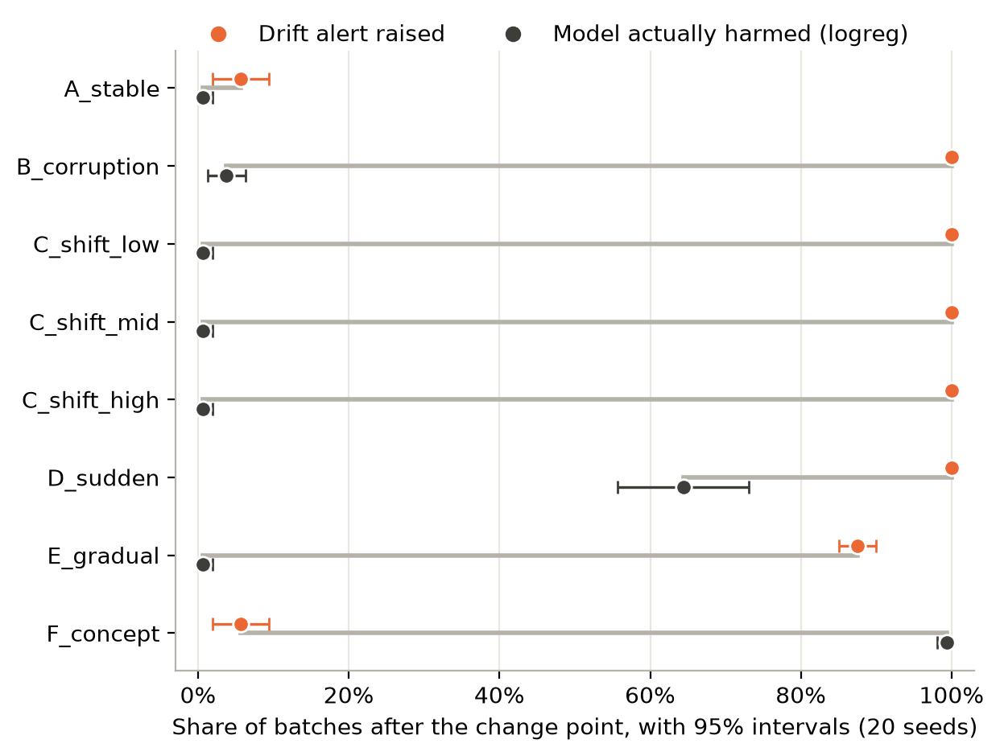
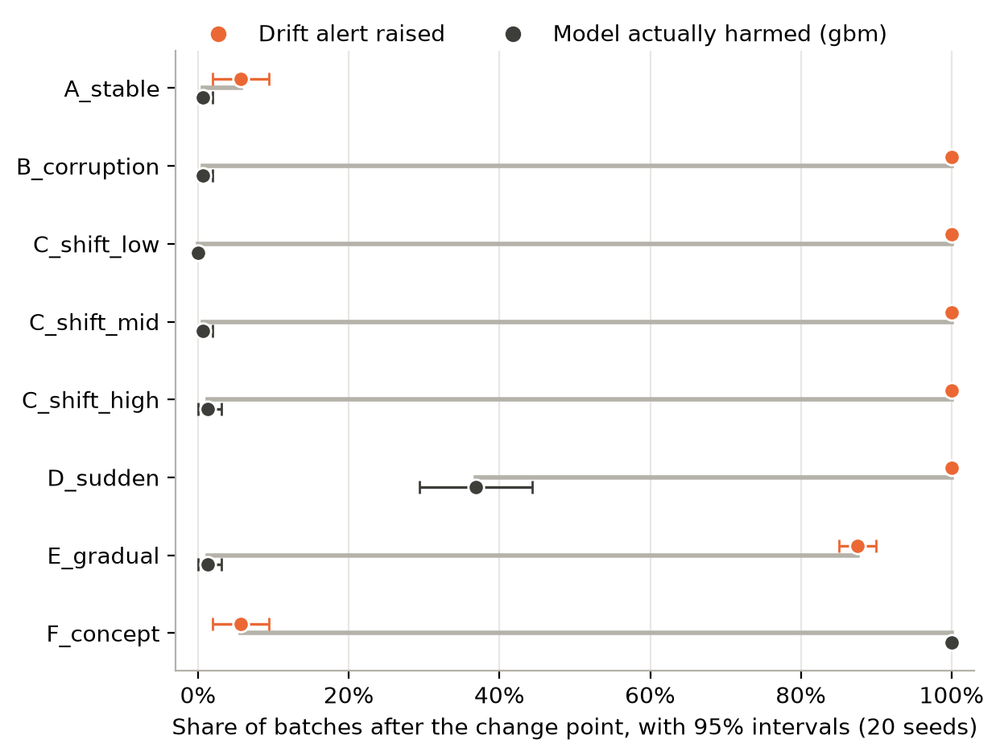
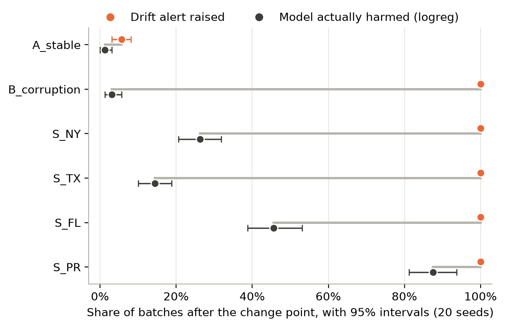
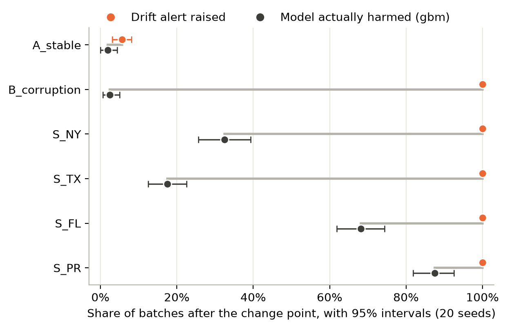

# Do Monitoring Alerts Mean Model Harm? Separating Distribution Change, Data Corruption and Performance Harm in Tabular ML Monitoring

Alishba Ansari
Independent researcher, Mumbai, India
alishba25ansari@gmail.com

---

## Abstract

We separate three questions that monitoring evaluations often merge: whether
a model's inputs changed, whether they are corrupted, and whether the model
was harmed. We compare four monitoring strategies (no monitoring, data-quality
checks only, statistical drift detection only, and both combined) and score
every alert against each question separately, on two tabular income-prediction
tasks and two model families, logistic regression and gradient-boosted trees.
On UCI Adult, eight controlled scenarios over 20 seeds (2,560 batches) cover
data corruption and sudden, gradual and label-relationship changes. On
Folktables ACSIncome, models trained on California are monitored on real,
unmodified people from four other US populations (1,920 batches). Drift
detection found 98% of controlled input changes and every real one, with about
5 false alerts per 100 unchanged batches. Yet only 12% [95% CI 10-14%] of its
alerts on Adult and 33% [30-36%] on ACS fell on batches where logistic
regression was harmed, meaning its ROC-AUC fell more than 0.03 below baseline.
A change in the label relationship harmed both models in almost every batch
while drift alerts stayed at their false-alert rate; conversely, every real
population triggered an alert on every batch, while the share of harmed
batches ranged from 14% to 88%. Under identical alerts, which changes harmed
the model depended on the model. Without a quality gate, drift detection
attributed every corrupted batch to a shift in one feature; the combined
strategy named the correct cause. These conclusions hold for harm thresholds of
0.02 and 0.05, except whether one moderate shift counts as harmful. Input
monitoring shows that data changed, not whether the model degraded.

## 1. Introduction

A deployed machine-learning model keeps producing predictions regardless of
the data it receives. That data may be malformed (for example, missing values,
impossible numbers or unknown categories) or valid but different from the
training data (for example, because the population has changed). Many of these
changes do not harm the model's predictions, while some do. A monitoring
system can therefore be asked three separate questions:

1. Have the inputs changed?
2. Are the inputs corrupted?
3. Has the model actually got worse?

We keep these three questions separate throughout. A *distribution change* is
any difference between incoming inputs and the training data, such as a new
mix of people. *Data corruption* is input that is invalid: missing required
values, impossible numbers, unknown categories, duplicated records.
*Performance harm* is a measurable drop in the model's predictive quality on
the batch. A drift detector answers the first question, a data-quality gate
the second, and only labels can answer the third. The three are easily
conflated: corrupted values can look like a distribution change to a drift
test, a large distribution change can leave a model's performance intact, and
a change in the relationship between inputs and labels can harm the model
while leaving the inputs, and so every input monitor, unchanged.

In production ML systems, it is common practice to validate data quality and to
monitor statistical drift [Breck et al. 2019; Schelter et al. 2018]. Simple
per-feature drift tests have been found to be effective detectors of dataset
shift [Rabanser et al. 2019], and many shifts are harmless, so detecting
harmful shifts requires knowledge of model performance [Podkopaev & Ramdas
2022]. In the work we reviewed, we did not find a comparison of quality-only,
drift-only and combined monitoring in which every alert is scored against
input change, corruption and observed performance harm on the same batches.

This paper asks: how effectively can data-quality checks combined with drift
detection distinguish harmful distribution changes from harmless changes in
machine-learning input data? We build a minimal end-to-end batch pipeline and
run two experiments: a controlled experiment with known changes, so that each
alert can be checked against what actually happened, and a real-shift
experiment in which the change is a genuine difference between populations.

Our contribution is empirical. The individual components we use (per-feature
drift tests, rule-based data validation, and the observation that drift and
harm differ) are all established. What we add is an evaluation that measures
them against each other:

1. **Three separate ground truths on the same batches.** Every batch records
   whether its inputs changed, whether they were corrupted, and whether the
   model was harmed, and every alert is scored against each. This lets us
   report, for the same alerts, how well they detect change, whether they
   attribute corruption correctly, and how often they coincide with harm.
2. **A controlled and a real-shift setting.** Eight controlled scenarios on
   UCI Adult (corruption; sudden, gradual and label-relationship changes), and
   real geographic shift on Folktables ACSIncome, where models trained on
   California are monitored on four other US populations.
3. **Two model families and quantified uncertainty.** Logistic regression and
   gradient-boosted trees, 20 seeds per scenario, 95% confidence intervals from
   a bootstrap over seeds, and a sensitivity analysis of the harm threshold.
4. **Full reproducibility.** Configurations committed before each run, and
   code that rebuilds every number and figure. The original experiment was
   reproduced exactly by an independent containerised rerun.

We test four hypotheses:

- **H1 (corruption):** A data-quality gate catches malformed, missing,
  duplicated or out-of-range records that drift detection alone may not
  classify correctly.
- **H2 (combining monitors):** Combining quality and drift monitoring is more
  informative than either alone, though it may not be better on every measure.
- **H3 (change):** Drift detection depends on the type and magnitude of the
  shift.
- **H4 (change vs. harm):** Feature drift does not always correspond to poorer
  predictive performance.

## 2. Related work

We organise prior work by which of the three questions it addresses:
whether the input distribution has changed, whether the input data is
corrupted, and whether the model's performance has been harmed. Table 1
summarises the comparison.

**Detecting distribution change.** Gama et al. [2014] and Lu et al. [2019]
survey learning under concept drift and establish the vocabulary used here:
sudden and gradual drift, and the distinction between a change in the input
distribution and a change in the relationship between inputs and labels.
Rabanser et al. [2019] compare methods for detecting dataset shift and find
that per-feature univariate tests with a Bonferroni correction perform
comparably to multivariate two-sample tests; our drift detector follows this
design. Poenaru-Olaru et al. [2022] ask whether drift detectors are reliable
as alarm systems, measuring detection latency and false alarms, and conclude
that they are not fully reliable. Both studies evaluate how well a detector
finds a change. We take detection as largely solved for the shifts we study
and ask a different question: what a correct detection tells an operator
about the model.

**Detecting corrupted data.** Breck et al. [2019] describe schema-based data
validation in Google's TFX platform, Schelter et al. [2018] declarative
data-quality verification at Amazon, and Sculley et al. [2015] identify data
dependencies as a source of hidden technical debt in ML systems. This work
treats validation as a separate safeguard; it does not measure what a drift
detector reports when corrupted data reaches it, or whether a quality failure
harms the model. We measure both.

**Establishing performance harm.** Several works argue that a shift matters
only if it degrades the model. Rabanser et al. [2019] approximate a shift's
malignancy with a heuristic that needs a labelling function. Podkopaev and
Ramdas [2022] track a deployed model's risk with sequential tests that use
labels and raise an alarm only for harmful shifts. Dong et al. [2024] identify
regions of the input space where a model is less accurate and treat covariate
shift as harmful only when more serving data falls into them, then mitigate it
by retraining with expert labels. These methods detect harm well, but each
requires labels at monitoring time and none evaluates a conventional input
monitor against harm. Our study is complementary: it measures how often the
alerts of label-free monitors, which are what most pipelines run, coincide
with harm that labels later reveal.

**Tools and benchmarks.** Evidently is a widely used open-source monitoring
library; with reference data of more than 1,000 rows it uses distance
measures rather than hypothesis tests by default [Evidently AI]. Folktables
[Ding et al. 2021] and TableShift [Gardner et al. 2023] provide tabular data
with real, naturally occurring shifts, and Ding et al. document limitations
of the UCI Adult dataset. We use Folktables for our real-shift experiment.

**Table 1.** Which of the three questions each line of work addresses.

| Work | Distribution change | Data corruption | Performance harm | Labels needed when monitoring |
| --- | --- | --- | --- | --- |
| Rabanser et al. 2019 | Detects | No | Approximated (heuristic) | For the harm estimate |
| Poenaru-Olaru et al. 2022 | Detects; evaluates reliability | No | Not measured | No |
| Breck et al. 2019; Schelter et al. 2018 | Partly (skew checks) | Detects | Not measured | No |
| Podkopaev & Ramdas 2022 | Not the target | No | Detects | Yes |
| Dong et al. 2024 | Detects covariate shift | No | Detects | Some (expert labels) |
| **This work** | **Detects; scored vs. truth** | **Detects; scored vs. truth** | **Measured; alerts scored vs. it** | **No (labels used only for evaluation)** |

## 3. Methods

All thresholds and drift-detection methods were fixed, and each experiment's
configuration was committed to version control, before that experiment's
first run.

### 3.1 Data and splits

**UCI Adult.** We use the UCI Adult (Census Income) dataset [Becker & Kohavi
1996], where the task is to predict whether a person's income exceeds $50K.
Cleaning was limited to stripping spaces from text values, converting "?" to
missing values, and removing a trailing full stop from some income labels,
leaving 48,842 rows of which 23.9% earn more than $50K.

The data was split, stratified by income with a fixed seed, into a training
split (29,305 rows, 60%), a test split (9,768 rows, 20%) and a monitor pool
(9,769 rows, 20%). The training split is used to fit the models, as the
reference for drift detection, and to define allowed categories; the test
split measures each model's baseline; and every incoming batch is built from
the monitor pool. The three splits share no rows.

**Folktables ACSIncome.** For real distribution shift we use the ACSIncome
task from Folktables [Ding et al. 2021]: 2018 American Community Survey data,
the same prediction target (income above $50,000), and ten features: age,
class of worker, education level, marital status, occupation, place of birth,
relationship, hours worked per week, sex and race. We sample 50,000 California
residents and split them 60/20/20 into training, test and monitor-pool sets
(stratified, seed 42), as for Adult; 41.4% of them earn more than $50,000. As
target populations we sample 10,000 residents each from New York, Texas,
Florida and Puerto Rico. Census answer codes are treated as categories; age,
education level and hours worked as numbers.

### 3.2 Models

We use two model families [Pedregosa et al. 2011], each in a single pipeline
with its preprocessing, learned from the training split only.

*Logistic regression.* Numeric features are median-imputed and standardised;
categorical features are imputed with the most frequent value and one-hot
encoded, ignoring categories not seen in training. On Adult the five numeric
features are age, education-num, capital-gain, capital-loss and
hours-per-week, and the seven categorical features are workclass,
marital-status, occupation, relationship, race, sex and native-country. We
exclude fnlwgt, a census sampling weight, and education, which duplicates
education-num.

*Gradient boosting.* To test whether the findings depend on the model family,
we also train a gradient-boosted tree ensemble (HistGradientBoostingClassifier,
default settings, seed 42), with median imputation for numeric features and
ordinal encoding for categorical ones.

Table 2 gives each model's baseline on its test split. On Adult, logistic
regression also reached PR-AUC 0.761, accuracy 0.852 and F1 0.659, and
gradient boosting PR-AUC 0.829, accuracy 0.873 and F1 0.712.

**Table 2.** Baseline ROC-AUC on the test split, and the harm threshold
derived from it (Section 3.5).

| Dataset | Model | Baseline ROC-AUC | Harmful if batch ROC-AUC below |
| --- | --- | --- | --- |
| Adult | Logistic regression | 0.9056 | 0.8756 |
| Adult | Gradient boosting | 0.9288 | 0.8988 |
| ACSIncome (CA) | Logistic regression | 0.8922 | 0.8622 |
| ACSIncome (CA) | Gradient boosting | 0.8987 | 0.8687 |

### 3.3 Data-quality checks

Each batch is first read as text, so that converting values to numbers is
itself a check rather than a silent step. Seven rules are applied (Table 3).
Critical failures make the whole batch unusable; errors cause only the
affected rows to be rejected.

**Table 3.** Data-quality rules, as configured for Adult.

| Rule | Fails when | Severity |
| --- | --- | --- |
| Not empty | The batch has no rows | Critical |
| Required columns | Any of the 12 feature columns is absent | Critical |
| Numeric type | A numeric column holds a non-number | Error |
| Not missing | A value is missing outside workclass, occupation and native-country | Error |
| Allowed category | A category never seen in the training split | Error |
| Range | age outside [17, 100], education-num outside [1, 16], capital-gain or capital-loss outside [0, 99999], hours-per-week outside [1, 99] | Error |
| Duplicate row | An exact copy of an earlier row in the batch (first copy kept) | Error |

Ranges were set from what is plausible rather than from the training minimum
and maximum, so that normal but rare values are not rejected. For ACSIncome
the same rules apply to its ten features, with ranges of [17, 99] for age,
[1, 24] for education level and [1, 99] for hours worked, and missing values
allowed only in class of worker. Every rule is recorded for every batch,
including rules with no failures.

### 3.4 Drift detection

Each batch is compared with the training split, since drift means "different
from what the model learned". Numeric features are tested with the two-sample
Kolmogorov-Smirnov (KS) test, which measures the largest gap between the two
cumulative distributions; categorical features are tested with a chi-square
test of their category proportions [Virtanen et al. 2020]. For categorical
features, missing values are treated as their own category, so a sudden rise
in missing values is visible, and categories with less than 1% of the
reference are grouped together, because chi-square is unreliable for
categories expected only a few times per batch.

With k features tested per batch, a per-test threshold of 0.05 would raise
frequent false alarms. We therefore apply a Bonferroni correction, flagging a
feature only when its p-value is below 0.05 / k: 0.0042 for Adult's 12
features and 0.005 for ACSIncome's 10. This targets a false-alert rate of at
most about 5% per unchanged batch. In a preliminary test on 100 stable
1,000-row Adult batches, the correction reduced batches with false alerts from
37 to 3. Because the features are correlated, the correction is stricter than
necessary.

A quality alert is raised when a batch is unusable or more than 1% of its
rows are rejected; a drift alert is raised when at least one feature drifts,
naming every drifted feature.

### 3.5 Experiment design

**Runs.** Each run is a sequence of 16 batches of 600 rows, processed in
order, built by shuffling the monitor pool with the run's seed and cutting
consecutive, non-overlapping batches. A scenario's change is applied from
batch 8 onwards, so batches 0-7 are always unchanged. Each scenario is run
with 20 seeds. For a given seed, every scenario starts from the same base
batches, so differences between scenarios are caused by the applied change
rather than by which rows were drawn.

**Controlled scenarios (Adult).** Table 4 lists the eight scenarios, giving
8 x 20 x 16 = 2,560 batches. Scenarios C, D and E keep every row valid, so
they test drift detection rather than the quality checks. Each applied change
and its severity is recorded per batch as ground truth, separately from
anything the monitors receive. An earlier run of the same design with five
seeds is identical to seeds 0-4 of this run.

**Table 4.** Controlled scenarios on Adult, applied to batches 8-15.

| Scenario | Change applied | Inputs changed? |
| --- | --- | --- |
| A_stable | None | No |
| B_corruption | 5% of rows broken, split evenly over missing age, sex = "Unknown", age = 250, hours-per-week = "forty", and duplicated rows | Yes |
| C_shift_low / mid / high | hours-per-week increased by 2, 5 or 10, rounded and clipped to [1, 99] | Yes |
| D_sudden | Batch rebuilt to be 70% Married-civ-spouse (about 46% in the full dataset) | Yes |
| E_gradual | age increased by 1.25 years at batch 8, growing linearly to 10 years at batch 15, clipped to [17, 100] | Yes |
| F_concept | Income label flipped for 35% of Married-civ-spouse rows; inputs unchanged | No |

**Real-shift scenarios (ACSIncome).** In each run, batches 0-7 are drawn from
the California monitor pool and batches 8-15 from one target state's sample,
without any modification; each run takes its own non-overlapping 4,800 rows of
the target sample. We also run a stable scenario and the same 5% corruption
scenario as for Adult, giving 6 scenarios x 20 seeds x 16 batches = 1,920
batches.

**What the monitors see.** Each batch is written to CSV and read back
through the pipeline's own reader, so monitors receive exactly what a real
file would provide. The income column is removed before monitoring; labels
are used only to compute the ground truth.

**Strategies.** Four strategies are evaluated on the identical batches.
*None* never alerts. *Quality only* raises the quality alert described above.
*Drift only* tests every feature on the raw batch, where non-numbers in
numeric columns become missing and invalid categories are kept. *Combined*
raises a quality alert, or a drift alert computed on the batch's valid rows.

**Ground truth.** Separate truths are recorded for every batch and never
combined. *Input changed* is known by construction: it is false for A, for F,
and for every batch before batch 8. *Corrupted* is true for batches 8-15 of B.
*Harmful* is recorded separately for each model: a batch is harmful for a
model when that model's ROC-AUC on the batch, computed with its true labels
and with no rows removed, is more than 0.03 below its own baseline ROC-AUC on
the test split (Table 2). For Adult logistic regression the baseline is 0.9056
(0.906 when rounded), so harmful means below 0.8756. Monitoring alerts do not depend on the model, so the two models share
the same alerts and differ only in which batches are harmful.

We use ROC-AUC rather than PR-AUC because PR-AUC also moves when the share of
high earners changes, as it does in D, even when the model ranks people
equally well. Over the 320 stable Adult batches, logistic regression's ROC-AUC
averaged 0.906 with a standard deviation of 0.013, so the threshold lies about
2.4 standard deviations below normal (2.4-2.8 for the other three
dataset-model pairs).

**Uncertainty.** We report 95% confidence intervals from a bootstrap over
seeds (2,000 resamples). Each seed is resampled as a whole run, because
batches within a seed are not independent: under the paired design, every
scenario starts from the same base batches. The harm threshold of 0.03 was
fixed in advance; we report 0.02 and 0.05 as a sensitivity analysis.

**Metrics.** We report alert precision and recall against each ground truth
separately, treating precision as undefined for a strategy that raises no
alerts; false alerts per 100 batches whose inputs did not change (1,600 on
Adult, 1,120 on ACSIncome); detection delay, the number of batches from batch
8 to a run's first alert, with missed runs counted separately; the mean
ROC-AUC and share of harmful batches after the change; which cause each
strategy reported for corrupted batches; and monitoring runtime.

**Comparison with Evidently.** Separately, we compared our detector with
Evidently's default data drift preset (version 0.7) on one clean and two
shifted 1,000-row Adult demonstration batches.

## 4. Results

### 4.1 Overall comparison

Table 5 summarises each strategy on Adult against the ground truths.

**Table 5.** Strategy performance over all 2,560 Adult batches, with 95%
confidence intervals.

| Strategy | Recall (input change) | Precision (input change) | False alerts / 100 quiet batches | Alerts on harmful batches: logreg | Alerts on harmful batches: gbm | Harmful batches alerted (logreg) |
| --- | --- | --- | --- | --- | --- | --- |
| None | 0.000 | undefined | 0 | undefined | undefined | 0 of 289 |
| Quality only | 0.167 | 1.000 | 0 | 0.038 [0.013, 0.063] | 0.006 [0.000, 0.019] | 6 of 289 |
| Drift only | 0.979 [0.975, 0.983] | 0.920 [0.890, 0.950] | 5.1 [3.1, 7.3] | 0.119 [0.100, 0.141] | 0.072 [0.058, 0.088] | 122 of 289 |
| Combined | 0.979 [0.975, 0.983] | 0.920 [0.890, 0.950] | 5.1 [3.1, 7.3] | 0.119 [0.100, 0.141] | 0.072 [0.058, 0.088] | 122 of 289 |

"Quiet" batches are the 1,600 whose inputs were not changed. "Harmful" means
a ROC-AUC more than 0.03 below the model's own baseline (Table 2); 289 batches
were harmful for logistic regression and 226 for gradient boosting.

Drift-only and combined monitoring made identical alert decisions on every
batch. Both detected input changes with high recall and precision, but most
of their alerts fell on batches where neither model was harmed.

### 4.2 Detection by scenario

**Figure 1.** Share of changed batches (batches 8-15, all seeds) that raised
an alert, by strategy and scenario.

Quality checks alerted on every corrupted batch (B) and on nothing else
(Figure 1). Drift detection alerted on every changed batch in B, in all three
hours-per-week shifts (C) and in the sudden marital-status shift (D); on 87.5%
[85.0, 90.0] of batches in the gradual age shift (E); and on 5.6% [1.9, 9.4]
of batches in the label-relationship change (F), the same rate as on stable
batches (A).

Even the smallest shift, +2 hours per week, was detected in every batch. A
likely explanation is that hours-per-week is strongly concentrated at 40, so
moving every value creates a large step in the cumulative distribution, which
the KS test detects easily; we did not test this explanation directly.

### 4.3 False alerts

In the preliminary test, checking 12 features at p < 0.05 without correction
raised an alert on 37 of 100 stable batches, compared with 3 of 100 with the
Bonferroni correction. In the main experiment, drift detection raised 82
alerts on 1,600 unchanged Adult batches, 5.1 per 100 [3.1, 7.3], consistent
with the 5% per-batch target of the correction. An earlier five-seed run had
given 1.0 per 100 [0.0, 2.0]; with four times the seeds, that estimate proved
low. On ACSIncome the rate was 6.2 per 100 [3.8, 8.4] (69 of 1,120).

### 4.4 Detection delay

**Figure 2.** Share of the 20 runs with a drift alert at each batch. B and
all three C scenarios follow the same line as D and are omitted.

Sudden changes (B, C, D) were detected at the first changed batch in every
run (Figure 2). The gradual age shift was detected at +1.25 years (batch 8)
in 2 of 20 runs, at +2.5 years in 16 and at +3.75 years in 2, a mean delay of
1.0 batch. No run missed an input change entirely.

### 4.5 Alerts versus harm

**Figure 3.** For each Adult scenario, the share of batches after the change
point that raised a drift alert (orange) and the share where logistic
regression was actually harmed (black), with 95% confidence intervals over 20
seeds. Figure A1 shows the same for gradient boosting.

**Figure 4.** Mean logistic-regression ROC-AUC across the 16 batches of each
run, averaged over 20 seeds.

Only two scenarios harmed the models (Figures 3 and 4). The marital-status
shift (D) was harmful for logistic regression in 64.4% [55.6, 73.1] of changed
batches (mean ROC-AUC 0.870) and was detected in all of them. The
label-relationship change (F) was harmful in 99.4% [98.1, 100] of batches
(mean ROC-AUC 0.839), but drift alerts appeared on only 5.6%, matching the
false-alert rate. Every other scenario stayed near the baseline (mean ROC-AUC
0.902-0.907) despite near-constant drift alerts in B, C and E. Per-scenario
values for both models are given in Table A1.

### 4.6 Attribution of corrupted batches

On the 160 corrupted Adult batches, drift-only monitoring alerted every time
but reported a distribution change in sex in all 160 (alone in 149, alongside
other features in 11), because the invalid value "Unknown" appeared as a new
category. The combined strategy reported a quality problem in all 160, with
drift also present in the valid rows of 10. On ACSIncome the pattern was the
same: drift-only blamed sex in all 160 corrupted batches (alone in 149), and
the combined strategy reported a quality problem in all 160.

### 4.7 Comparison with Evidently

On the three demonstration batches, our detector and Evidently agreed on 33
of 36 feature decisions. Both were silent on the clean batch and both flagged
only age in the age-shifted batch. All three disagreements were small changes
in the marital-status-shifted batch: our detector flagged occupation and sex
(Jensen-Shannon distances 0.069 and 0.081), both below Evidently's 0.1
threshold, while Evidently flagged hours-per-week at 0.101, which our KS test
did not. With a reference of more than 1,000 rows, Evidently used Wasserstein
distance for numeric and Jensen-Shannon distance for categorical features;
these measure the size of a change, while our p-values measure how certain it
is that a change exists, which explains the disagreements.

### 4.8 Runtime

Quality checks plus drift tests took about 210 ms per 600-row Adult batch and
180 ms per ACSIncome batch (medians) on a personal laptop without a GPU.

### 4.9 A second model

Gradient boosting was harmed in 226 of 2,560 Adult batches, against 289 for
logistic regression, and was less affected by the marital-status shift: D was
harmful for it in 36.9% [29.4, 44.4] of changed batches (mean ROC-AUC 0.902,
a drop of 0.027) against 64.4% for logistic regression (a drop of 0.036). F
harmed both models in almost every batch. Because the alerts are identical for
both models, the share of drift alerts on harmful batches fell from 0.119 for
logistic regression to 0.072 [0.058, 0.088] for gradient boosting: the same
alerts were even less informative about harm for the stronger model.

### 4.10 Real shift across US states

Table 6 shows the real-shift results. On stable California batches, drift
detection alerted on 5.6% of batches after the change point. On real
populations from every other state it alerted on every batch, from the first
changed batch in every run. Race and place of birth drifted in every batch from
every state; Puerto Rico also differed in every batch in occupation, marital
status, class of worker, relationship and hours worked.

**Table 6.** Real shift on ACSIncome: batches 8-15, 20 seeds, 95% confidence
intervals.

| Batches 8-15 from | Drift alerts | Harmed: logreg | Harmed: gbm | Mean ROC-AUC (logreg / gbm) |
| --- | --- | --- | --- | --- |
| California (stable) | 0.056 [0.031, 0.081] | 0.012 | 0.019 | 0.893 / 0.898 |
| California, corrupted | 1.000 | 0.031 | 0.025 | 0.886 / 0.898 |
| Texas | 1.000 | 0.144 [0.100, 0.188] | 0.175 [0.125, 0.225] | 0.876 / 0.882 |
| New York | 1.000 | 0.262 [0.206, 0.319] | 0.325 [0.256, 0.394] | 0.870 / 0.875 |
| Florida | 1.000 | 0.456 [0.388, 0.531] | 0.681 [0.619, 0.744] | 0.863 / 0.862 |
| Puerto Rico | 1.000 | 0.875 [0.812, 0.938] | 0.875 [0.819, 0.925] | 0.838 / 0.839 |

Harm differed widely between states that drift detection treated identically:
logistic regression was harmed in one batch in seven from Texas and in seven
in eight from Puerto Rico. Because every changed batch raised an alert, drift
detection missed almost no harmful batch (283 of 285 for logistic regression,
333 of 336 for gradient boosting), but only 32.6% [29.7, 35.7] of its alerts
fell on batches harmful for logistic regression, and 38.3% [35.8, 40.9] for
gradient boosting. The ranking of models also changed with the population:
gradient boosting was harmed more often than logistic regression in Florida
(68.1% against 45.6%), the reverse of Adult's marital-status shift.

Real data also blurred the line between corruption and change. In every
target state some rows were rejected because a category was absent from the
California training data: 71 of the 10,000 New York residents (0.7%) had a
place-of-birth code that never occurred among the 30,000 California training
rows, and no other column had unseen values. Rejection rates averaged 0.2-0.3%
of rows in Texas, Florida and Puerto Rico and 0.75% in New York, where 21
batches, in 15 of 20 runs, crossed the 1% quality-alert threshold. These are
valid answers that a schema learned from one population treats as invalid.

### 4.11 Sensitivity to the harm threshold

Table 7 repeats the main comparison with harm thresholds of 0.02 and 0.05.

**Table 7.** Number of harmful batches, and share of drift alerts on harmful
batches, at three harm thresholds (0.03 was fixed in advance).

| Dataset | Model | Harmful batches (0.02 / 0.03 / 0.05) | Drift alerts on harmful batches (0.02 / 0.03 / 0.05) |
| --- | --- | --- | --- |
| Adult | Logistic regression | 463 / 289 / 157 | 0.201 / 0.119 / 0.027 |
| Adult | Gradient boosting | 389 / 226 / 162 | 0.160 / 0.072 / 0.011 |
| ACSIncome | Logistic regression | 463 / 285 / 117 | 0.491 / 0.326 / 0.135 |
| ACSIncome | Gradient boosting | 482 / 336 / 144 | 0.518 / 0.383 / 0.166 |

The central result is stable: at every threshold, for both models and both
datasets, at most about half of drift alerts coincided with harm, and on Adult
at most one in five. The label-relationship change (F) is harmful under all
three rules (85-100% of batches for both models), while drift alerts on it
stay at the false-alert rate. On ACSIncome, the ranking of states by harm
(Texas < New York < Florida < Puerto Rico) is the same at every threshold for
both models.

The marital-status shift (D) is the exception. Its mean ROC-AUC falls by
0.036 for logistic regression and 0.027 for gradient boosting, close to the
thresholds themselves, so it is harmful in 90.0% / 64.4% / 13.1% of batches
for logistic regression and 74.4% / 36.9% / 1.2% for gradient boosting at
0.02 / 0.03 / 0.05. Whether a moderate shift counts as harmful therefore
depends both on the model and on a threshold that has to be chosen in advance,
which is a further reason a drift alert cannot settle the question on its own.

## 5. Discussion

**H1 (corruption): supported.** On both datasets the quality gate caught
every corrupted batch and named the cause. Drift detection alone also alerted,
but for the wrong reason: corrupted values looked like a shift in one feature.
An operator acting on those alerts would investigate the wrong problem. Real
data adds a caveat: a schema learned from one population rejected valid
answers from another, so a quality alert can also signal a new population.

**H2 (combining monitors): partly supported.** Combining the two methods did
not improve detection or harm-finding on either dataset; its alert decisions
were identical to drift-only. Its value was diagnostic: it separated
corruption from distribution change. We therefore do not find that combined
monitoring wins on detection metrics.

**H3 (change): partly supported.** Shift type mattered: sudden synthetic
shifts and all four real populations were caught at once, the gradual shift
about one batch later, and the label-relationship change not at all. Severity
mattered less than expected for hours-per-week, where even the smallest shift
was always detected, which suggests that detection depends on a feature's
distribution shape as well as on the size of the shift.

**H4 (change vs. harm): supported.** Most drift alerts did not coincide with
harm: for logistic regression, 88% of drift alerts on Adult and 67% on
ACSIncome fell on batches where the model performed normally. Feature
monitoring could neither confirm harm, since it alerted equally on D, which
was harmful, and on C and E, which were not, and equally on Texas and Puerto
Rico; nor detect it, since it missed F. This is consistent with Podkopaev and
Ramdas [2022] and supports measuring performance directly whenever labels
become available.

**Harm depends on the model, alerts do not.** Monitoring alerts are computed
from the inputs alone, so they were identical for both models, yet the models
disagreed about which changes harmed them: gradient boosting was harmed less
than logistic regression by the marital-status shift and more by the Florida
population. A drift alert describes the data; whether that data harms a
particular model is a separate fact.

**What separating the three questions shows.** Scored against input change
alone, drift detection looks nearly perfect. Scored against corruption, it
alerts on every corrupted batch but names the wrong cause, a shift in one
feature. Scored against harm, most of its alerts are on batches the model
handles normally, and it misses the change that harms the model most. The
same alerts support three different verdicts depending on which question is
asked. The two datasets show this from opposite directions: on Adult, drift
alerts missed the most harmful change; on real geographic shift, they caught
every harmful batch but could not tell a mildly harmful population from a
severely harmful one. Evaluations that report only detection, as is common
for drift detectors, therefore say little about whether an operator should
act.

**Practical implication.** In a pipeline like this one, drift alerts are best
treated as a prompt to check model performance rather than as evidence that
the model has degraded, and quality checks should run first so that corrupted
data is not mistaken for distribution change.

## 6. Limitations

- Two datasets, both from US census income data (1994 and 2018), two model
  families and one family of drift tests; other domains, models and detectors
  may behave differently [Ding et al. 2021].
- The Adult changes are synthetic. The ACSIncome shift is real but geographic
  only and from a single year; temporal shift was not tested.
- Harm is defined by a ROC-AUC rule. The sensitivity analysis shows the main
  conclusions hold at 0.02 and 0.05, but whether D is harmful does not.
  ROC-AUC itself depends on the mix of people in a batch, so part of a
  measured drop under a population change, in D and in the ACSIncome states,
  may reflect the new population rather than a less accurate model.
- The paired design reuses base batches across scenarios. Of the 289 batches
  harmful for logistic regression on Adult, 23 fall outside D and F; 18 of
  these are three base batches repeated across the six scenarios that share
  them. The confidence intervals resample whole seeds to account for this
  dependence. Scenario D samples from the whole monitor pool, so its batches
  can repeat rows from other batches in the same run.
- The quality schema is learned from one population, so valid but unseen
  categories in a new population are rejected as invalid.
- The KS test is conservative for features with many tied values, such as
  capital-gain and capital-loss, which are mostly zero.
- The combined strategy uses no performance signal, since labels are rarely
  available immediately; strategies using delayed labels were not tested.
- The Evidently comparison used only three batches.

## 7. Conclusion and future work

On a controlled and a real-shift benchmark, with two model families,
statistical drift detection reliably detected changes in input data but was a
poor indicator of model harm. On controlled shifts, most of its alerts were on
harmless changes and the most harmful change produced no alerts; on real
populations, it alerted on everything and could not distinguish mild from
severe harm. Which changes were harmful depended on the model, under
identical alerts. A data-quality gate added nothing to detection but correctly
separated corrupted data from genuine distribution change.

Future work should test temporal shift (for example, ACSIncome across survey
years), strategies that use delayed labels to monitor performance directly,
and other drift detectors and multiple-testing corrections.

## Reproducibility

Code, configuration and results are available at
https://github.com/alishba25/driftguard. Each experiment's configuration
(experiments/configs/main.yaml, adult_20seeds.yaml and acs_states.yaml) was
committed before its first run. `python experiments/run_experiments.py
<config>` reruns an experiment; `experiments/summarize.py`,
`experiments/analyze.py` and `experiments/make_figures.py` rebuild every
table, confidence interval and figure; and `src/prepare_acs.py` downloads and
prepares the ACSIncome data. The original five-seed experiment was reproduced
exactly by a local rerun and an independent Docker rerun with a fresh data
download and model training, and its 640 batches are identical to seeds 0-4
of the 20-seed experiment. Exact library versions are recorded in
requirements-lock.txt and requirements-lock-docker.txt.

## References

Becker, B., & Kohavi, R. (1996). Adult [Dataset]. UCI Machine Learning Repository. https://archive.ics.uci.edu/dataset/2/adult

Breck, E., Zinkevich, M., Polyzotis, N., Whang, S. E., & Roy, S. (2019). Data validation for machine learning. In *Proceedings of Machine Learning and Systems (SysML) 2019*.

Ding, F., Hardt, M., Miller, J., & Schmidt, L. (2021). Retiring Adult: New datasets for fair machine learning. In *Advances in Neural Information Processing Systems 34*. https://arxiv.org/abs/2108.04884

Dong, S., Wang, Q., Sahri, S., Palpanas, T., & Srivastava, D. (2024). Efficiently mitigating the impact of data drift on machine learning pipelines. *Proceedings of the VLDB Endowment*, 17(11), 3072-3081. https://doi.org/10.14778/3681954.3681984

Evidently AI. (n.d.). Data drift: how data drift detection works. Retrieved 3 November 2026, from https://docs.evidentlyai.com/metrics/explainer_drift

Gama, J., Žliobaitė, I., Bifet, A., Pechenizkiy, M., & Bouchachia, A. (2014). A survey on concept drift adaptation. *ACM Computing Surveys*, 46(4), Article 44. https://doi.org/10.1145/2523813

Gardner, J., Popovic, Z., & Schmidt, L. (2023). Benchmarking distribution shift in tabular data with TableShift. In *Advances in Neural Information Processing Systems 36 (Datasets and Benchmarks Track)*. https://arxiv.org/abs/2312.07577

Lu, J., Liu, A., Dong, F., Gu, F., Gama, J., & Zhang, G. (2019). Learning under concept drift: A review. *IEEE Transactions on Knowledge and Data Engineering*, 31(12), 2346-2363. https://doi.org/10.1109/TKDE.2018.2876857

Pedregosa, F., et al. (2011). Scikit-learn: Machine learning in Python. *Journal of Machine Learning Research*, 12.

Podkopaev, A., & Ramdas, A. (2022). Tracking the risk of a deployed model and detecting harmful distribution shifts. In *International Conference on Learning Representations (ICLR)*. https://arxiv.org/abs/2110.06177

Poenaru-Olaru, L., Cruz, L., van Deursen, A., & Rellermeyer, J. S. (2022). Are concept drift detectors reliable alarming systems? A comparative study. arXiv:2211.13098. https://arxiv.org/abs/2211.13098

Rabanser, S., Günnemann, S., & Lipton, Z. C. (2019). Failing loudly: An empirical study of methods for detecting dataset shift. In *Advances in Neural Information Processing Systems 32*. https://arxiv.org/abs/1810.11953

Schelter, S., Lange, D., Schmidt, P., Celikel, M., Biessmann, F., & Grafberger, A. (2018). Automating large-scale data quality verification. *Proceedings of the VLDB Endowment*, 11(12), 1781-1794. https://doi.org/10.14778/3229863.3229867

Sculley, D., Holt, G., Golovin, D., Davydov, E., Phillips, T., Ebner, D., Chaudhary, V., Young, M., Crespo, J.-F., & Dennison, D. (2015). Hidden technical debt in machine learning systems. In *Advances in Neural Information Processing Systems 28*.

Virtanen, P., et al. (2020). SciPy 1.0: Fundamental algorithms for scientific computing in Python. *Nature Methods*, 17.

---

## Appendix

**Table A1.** Adult, per scenario: batches 8-15 over 20 seeds, with 95%
confidence intervals.

| Scenario | Drift alerts | Harmed: logreg | Harmed: gbm | Mean ROC-AUC (logreg / gbm) |
| --- | --- | --- | --- | --- |
| A_stable | 0.056 [0.019, 0.094] | 0.006 [0.000, 0.019] | 0.006 [0.000, 0.019] | 0.906 / 0.930 |
| B_corruption | 1.000 | 0.038 [0.013, 0.063] | 0.006 [0.000, 0.019] | 0.902 / 0.929 |
| C_shift_low | 1.000 | 0.006 [0.000, 0.019] | 0.000 | 0.907 / 0.930 |
| C_shift_mid | 1.000 | 0.006 [0.000, 0.019] | 0.006 [0.000, 0.019] | 0.907 / 0.929 |
| C_shift_high | 1.000 | 0.006 [0.000, 0.019] | 0.013 [0.000, 0.031] | 0.907 / 0.927 |
| D_sudden | 1.000 | 0.644 [0.556, 0.731] | 0.369 [0.294, 0.444] | 0.870 / 0.902 |
| E_gradual | 0.875 [0.850, 0.900] | 0.006 [0.000, 0.019] | 0.013 [0.000, 0.031] | 0.906 / 0.927 |
| F_concept | 0.056 [0.019, 0.094] | 0.994 [0.981, 1.000] | 1.000 | 0.839 / 0.844 |

**Figure A1.** As Figure 3, for gradient boosting.

**Figure A2.** Real shift on ACSIncome: share of batches after the change
point that raised a drift alert and that harmed logistic regression, with 95%
confidence intervals over 20 seeds.

**Figure A3.** As Figure A2, for gradient boosting.